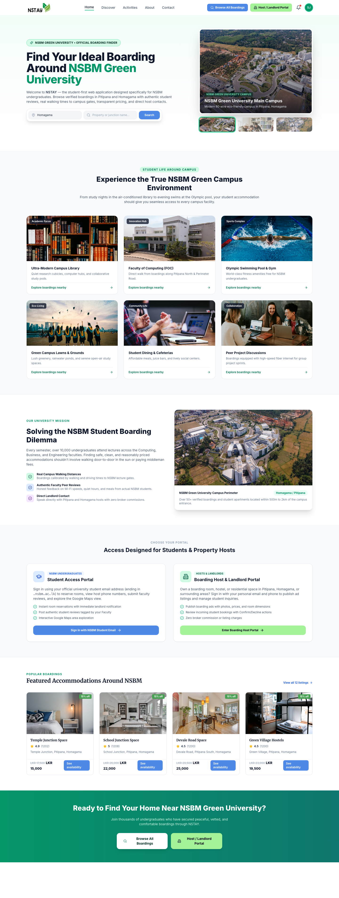
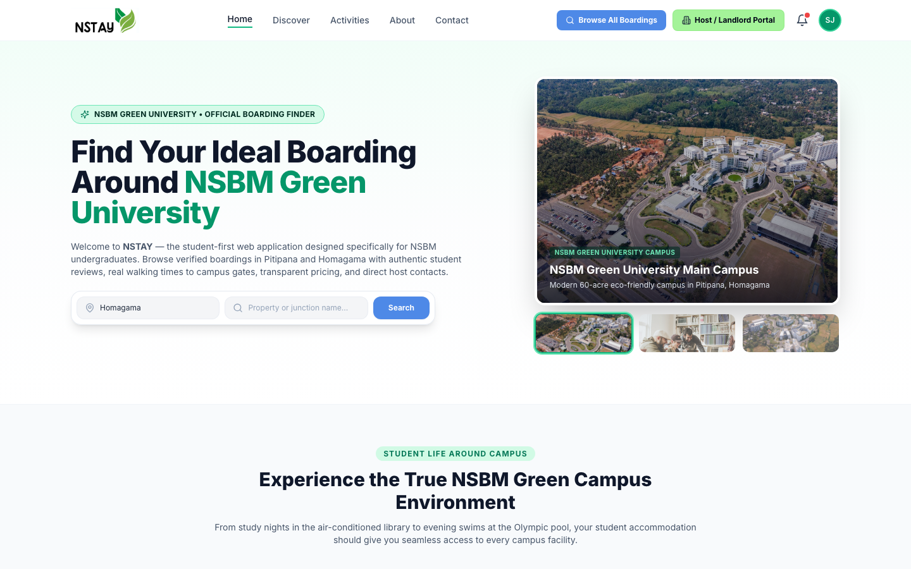
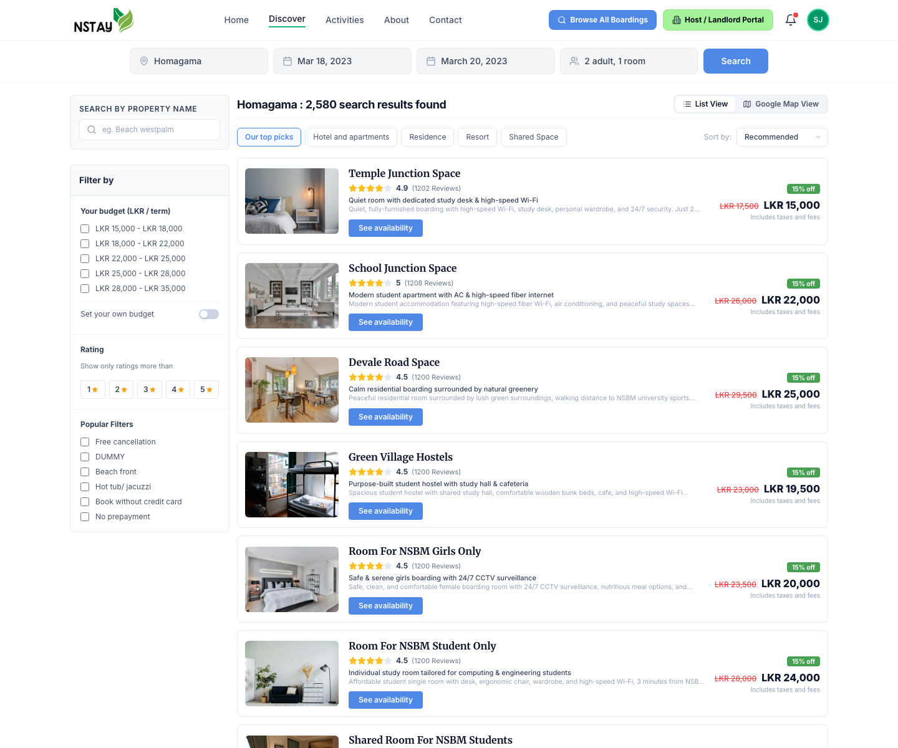
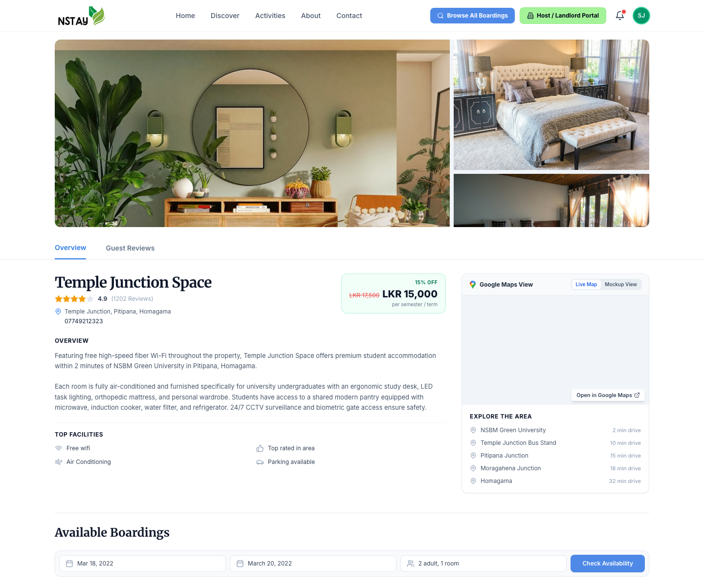
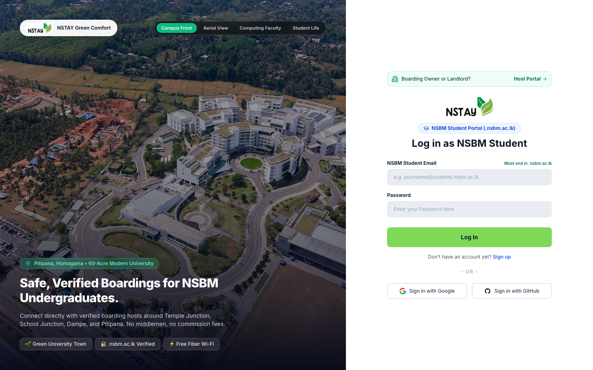
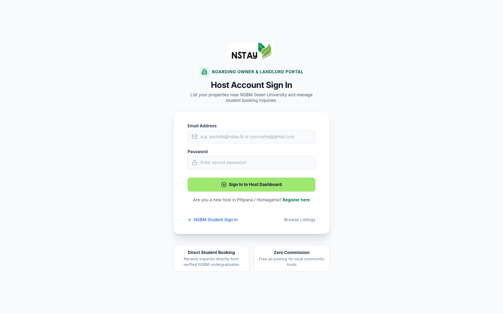
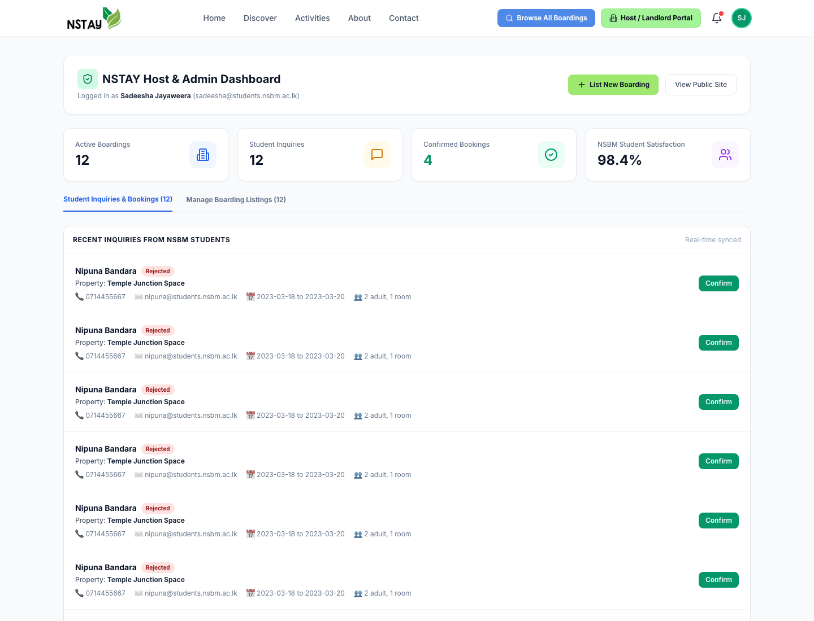
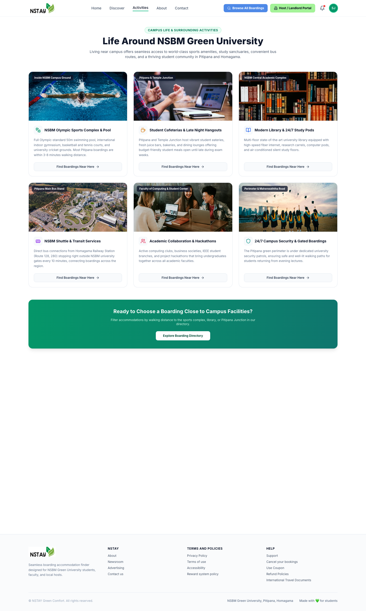
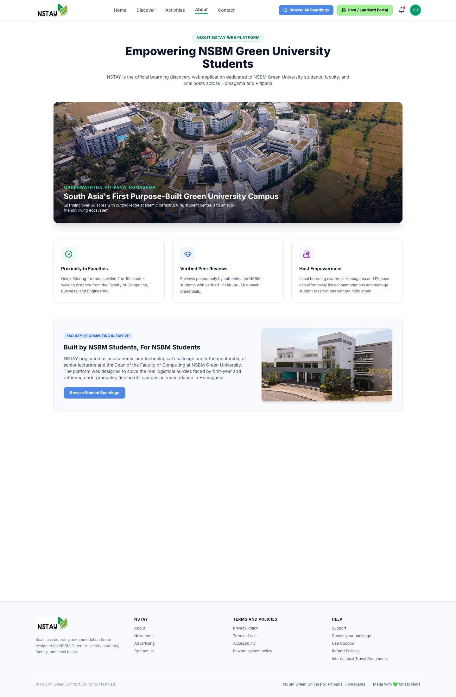
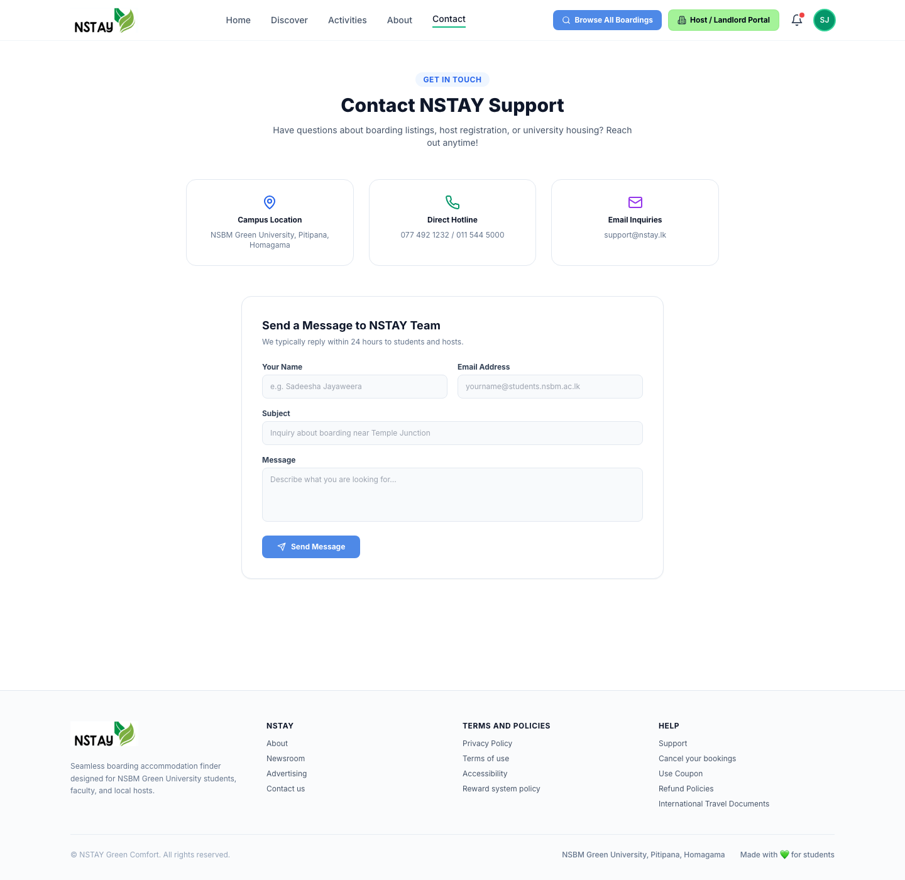

# NSTAY Web Application 🏡🌿🎓

[](https://react.dev/)
[](https://tailwindcss.com/)
[](https://nodejs.org/)
[](https://socket.io/)
[-emerald)](#)
[](#testing-)

> **NSTAY** is the student-first web application engineered specifically for **NSBM Green University** undergraduates, faculty, and local boarding hosts in Homagama and Pitipana, Sri Lanka. Built on the modern MERN architecture with interactive map views, strict academic domain validation, and real-time host notifications.

---

## 📸 Application Showcase & Screenshots

### 1. Modern Homepage & Green Campus Proximity Finder
*Featuring real NSBM student life photography, quick junction search, parallel navigation actions, and complete campus guide.*

<details open>
<summary><b>View Full Scrollable Homepage</b></summary>


</details>

*Top Hero & Navigation View:*


---

### 2. Verified Boardings Directory & LKR Budget Filtering
*Catalog with LKR 15,000 – LKR 30,000 price range, interactive budget sliders, star ratings, and Google Map toggle.*



---

### 3. Detailed Accommodation View & Campus Walking Distance
*3-photo property gallery, bedroom specifications, real walking times to NSBM gates, and student reviews.*



---

### 4. NSBM Student Portal
*Split-screen authentication enforcing `@*.nsbm.ac.lk` university emails for authentic undergraduate reviews and bookings.*



---

### 5. Boarding Host & Landlord Portal
*Dedicated gateway for local property owners to list rooms, manage inquiries, and track vacancies.*



---

### 6. Host & Admin Management Dashboard
*Live metrics, listing controls, reservation review pipelines, and vacancy management.*



---

### 7. Campus Life & Surrounding Activities (`/activities`)
*Comprehensive guide to NSBM sports complex, swimming pool, late-night student hangouts, transit hubs, and study pods.*



---

### 8. About NSTAY & Faculty of Computing (`/about`)
*Aerial university photography, project origin under the Faculty of Computing, and mission highlights.*



---

### 9. Student Support & Inquiries (`/contact`)
*Interactive inquiry submission, 24/7 student helpline contacts, and direct university campus coordinates.*



---

## 🌟 Key Features & Recent Updates

- 🇱🇰 **Localized Currency**: Standardized across the entire application to **LKR (Sri Lankan Rupees)** with authentic pricing starting from **LKR 15,000 to LKR 30,000/month**.
- 📸 **High-Definition Imagery**: Sourced real student-life and room interior photography, completely replacing low-resolution placeholders.
- 🧭 **Refined Top Navigation**: Symmetrical **Browse All Boardings** (Blue) and **Host / Landlord Portal** (Emerald Green) buttons embedded in the navbar with responsive mobile drawer support.
- 🎓 **Strict University Email Guard**: Enforces `@students.nsbm.ac.lk` or `@nsbm.ac.lk` domain validation on student registration.
- 📍 **Interactive Maps & Campus Proximity**: Calculates walking and drive times to NSBM Main Gates, Pitipana Junction, Temple Junction, and School Junction.
- 🔔 **Contextual Notifications**: Notification center displays booking inquiries and vacancies only when authenticated.
- 🛡️ **Dual-Role RBAC**: Independent access flows for NSBM undergraduates and Homagama boarding providers.

---

## 🛠️ Architecture & Tech Stack

| Layer | Technologies |
| :--- | :--- |
| **Frontend** | React 18, Vite 5, Tailwind CSS, React Router v6, Leaflet & React-Leaflet, Lucide Icons |
| **Backend** | Node.js (ES Modules), Express.js 4, Socket.io (WebSocket), Multer |
| **Security** | Bcrypt.js (salted password hashing), JSON Web Tokens (JWT), Role-Based Access Control |
| **Data Layer** | Cloud MongoDB / Mongoose models with automatic resilient local JSON store fallback (`server/data/db.json`) |
| **Maps & Geo** | Google Maps Embed API & OpenStreetMap / Leaflet with NSBM Green University coordinates |

---

## 📁 Project Structure

```
NSTAY-Web-App-/
├── screenshots/            # High-res UI screenshots for repo documentation
├── scripts/
│   └── capture_screenshots.sh # Automated headless screenshot capture utility
├── server/
│   ├── config/             # DB & server configurations
│   ├── data/               # Seed data & persistent JSON DB
│   ├── middleware/         # JWT auth & error handlers
│   ├── models/             # Mongoose schemas (Boarding, User, Inquiry)
│   ├── routes/             # REST API routes (auth, boardings, inquiries)
│   ├── test/               # Automated production test suite
│   └── server.js           # Express app & Socket.io server
├── src/
│   ├── assets/             # Real NSBM photography and room images
│   ├── components/         # Navbar, ListingCard, FilterSidebar, PostAdModal, etc.
│   ├── context/            # AuthContext, BoardingContext, ToastContext
│   ├── pages/              # HomePage, ListingPage, ProductPage, AuthPage, AdminPage
│   ├── App.jsx             # Route definitions & ErrorBoundary
│   ├── index.css           # Tailwind CSS directives
│   └── main.jsx            # React root entry
├── package.json            # Scripts & dependencies
├── tailwind.config.js      # Custom theme & font extensions
└── vite.config.js          # Vite config with vendor chunk optimization
```

---

## ⚙️ Environment Variables

Create a `.env` file in the root directory:

```env
PORT=5001
NODE_ENV=production
JWT_SECRET=your_secure_random_jwt_secret_key_here
MONGO_URI=mongodb://localhost:27017/nstay
```

---

## 🚀 Quick Start

### 1. Install Dependencies
```bash
npm install
```

### 2. Run in Development Mode
Launches both the Express backend (port 5001) and Vite dev server (port 3000):
```bash
npm start
```
Navigate to: **[http://localhost:3000](http://localhost:3000)**

### 3. Build for Production
Generates optimized and minified bundles in `dist/`:
```bash
npm run build
```

---

## 🧪 Automated Testing

Run the automated test suite verifying auth validation, bcrypt hashing, boardings CRUD, inquiries, and reviews:
```bash
npm test
```

### Test Coverage Highlights:
- ✅ Boardings catalog integrity (12+ verified listings)
- ✅ Detailed property lookup by ID
- ✅ Category & LKR budget range filters (LKR 15,000 - 30,000)
- ✅ Property name & junction proximity queries
- ✅ Strict NSBM student email domain validation
- ✅ Bcrypt password hashing & salt generation
- ✅ JWT token signature & claims verification
- ✅ Post Ad creation, database insertion, and cleanup
- ✅ Student reservation inquiry lifecycle
- ✅ Student review submission and dynamic rating calculation

---

## 🔒 Security & Performance Hardening

- **Bcrypt Salted Hashing**: 10 salt rounds for all user credentials.
- **JWT Protection**: Protected routes require valid bearer tokens.
- **Input Sanitization**: Clean string trimming, length bounds, and email regex checks.
- **Error Boundary**: React components wrapped in `ErrorBoundary` to prevent entire-app crashes.
- **Toast Notifications**: Accessible real-time feedback on all asynchronous actions.
- **Vendor Chunk Splitting**: Vendor, Leaflet, and icon modules bundled into distinct chunks under 350 kB.

---

## 📄 License

This project is licensed under the [MIT License](LICENSE).
